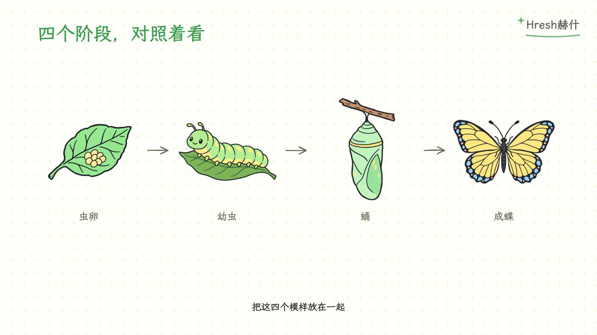

# Social Creator Toolkit

在 Codex 中使用的内容创作 Skill，主要提供两个功能：**爆款标题**和**爆款封面**。

给一份文档、讲稿、产品资料或视频，提炼值得点击的看点，生成适合平台的标题；也可以直接提供视频，制作风格统一、重点清楚的双比例封面。

| 核心功能 | 输入 | 输出 |
| --- | --- | --- |
| 爆款标题 | 文档、文章、讲稿、产品资料或视频 | 标题候选、主推标题、字符数与点击理由；按需补充发布文案 |
| 爆款封面 | 视频，可附讲稿、参考封面或账号规范 | 4:3 与 3:4 两版 PNG、缩略预览及制作说明，支持自定义品牌名 |

支持知乎、微信视频号、B站、抖音和小红书。两项功能可以单独使用，也可以一起完成。“爆款”代表创作方向，不承诺曝光、点击率或播放量。

## 看一个完整示例

**自然博物馆：从视频内容到封面。** 输入是一段约 68 秒的亲子科普视频，输出展示采用宋体标题、暖米色背景与蝴蝶主体的 4:3 封面。

| 输入视频：画面预览 | 输出封面：1600×1200 |
| --- | --- |
| [](examples/nature-museum-case/nature-museum-narrated.mp4) | [](examples/nature-museum-case/cover-4x3.png) |

[视频文件（MP4，约 4.5 MiB）](examples/nature-museum-case/nature-museum-narrated.mp4) · [封面原图](examples/nature-museum-case/cover-4x3.png) · [案例说明](examples/nature-museum-case/README.md)

克隆仓库后可直接用浏览器打开 [视频与封面对照页](examples/nature-museum-case/preview.html)，播放输入视频并查看封面。视频由用户提供，封面展示经过参考与迭代的输出效果；本例按用户要求仅制作 4:3。素材来源、设计过程与复现边界见案例说明。

## 快速开始

### 安装

在 Codex 中发送：

```text
使用 $skill-installer，安装 https://github.com/Acorn2/social-creator-toolkit。
Skill 位于仓库根目录，安装名称为 social-creator-toolkit。
```

等待安装完成后，在后续对话中使用 `$social-creator-toolkit`。如果技能未出现，重启 Codex 后再试。当前技能选择器中的名称为“爆款标题、发布文案与视频封面”。

本仓库由 `SKILL.md` 驱动，没有需要单独启动的应用服务。以下示例中的路径替换为你的文件路径；文字资料也可以直接粘贴。

### 生成爆款标题

```text
使用 $social-creator-toolkit，读取 <文档或讲稿路径>，
给小红书和B站各写三个视频标题，推荐一个，并说明点击理由。
```

### 制作爆款封面

```text
使用 $social-creator-toolkit，分析 <视频路径>，为这个视频制作封面。
生成4:3和3:4两版，品牌名用“星河工作室”。
参考 <已有封面或账号规范路径>，保持字体、配色和整体风格统一。
```

参考封面和账号规范不是必填项。没有现成规范时，会先采用一套视觉方案并记录，便于后续复用。

### 标题和封面一起做

```text
使用 $social-creator-toolkit，根据 <视频路径> 和 <讲稿路径>，
生成小红书视频标题、发布文案和4:3、3:4封面。
封面品牌名用“星河工作室”。
```

讲稿可选。有视频且要求完整视频发布包时默认包含双比例封面；只要标题、只改文案或明确只要文字时，不生成图片。

## 功能一：爆款标题

从“内容讲了什么”进一步找到“观众为什么愿意点开”。默认采用强传播表达，支持悬念、反差、场景代入、鲜明态度和口语表达；具体功能、数字、价格、效果和经历以素材为准。

### 生成方式

1. **选看点**：识别目标观众，寻找欲望、顾虑、乐趣、冲突或搜索需求。
2. **找表达**：结合标题方法与具体参考，打磨措辞、节奏和信息密度。
3. **比较候选**：每个平台默认精选三个标题，给出实际字符数、点击理由和一个主推。
4. **承接内容**：核对素材能否兑现标题中的承诺，再按平台入口调整表达。

跨平台可以复用强角度，不为了形式不同而选弱标题。需要搜索流量时，可加入主题词、需求词和长尾问法；没有查询数据时，不把选词称为热词。

### 常见用法

**产品宣传**

```text
使用 $social-creator-toolkit，根据 <宣传稿路径> 和 <产品资料路径>，
生成五平台视频标题，重点吸引目标用户了解产品。
```

**搜索流量**

```text
使用 $social-creator-toolkit，根据 <文档路径>，只写小红书标题，
重点覆盖“网页收藏找不到”的搜索需求。
```

**重写旧标题**

```text
使用 $social-creator-toolkit，读取 <旧发布包路径> 和 <原始资料路径>，
只重写抖音标题，保留其他平台、正文、话题和排期。
```

按需可扩展为完整发布包，补充简介或配文、话题、分类、产品入口、最小开头建议和发布时间建议。发布时间是待账号数据验证的起点，不代表实测最优。

方法详见 [标题策略](references/title-strategy.md)、[角度与表达工具](references/headline-formulas.md) 和 [搜索意图](references/search-intent.md)。[改写对照](examples/skill-rework-review.md) 可用于了解候选取舍，示例不代表发布成绩。

## 功能二：爆款封面

让观众在账号主页的缩略图里，一眼看清本条内容的重点，同时认出同一账号的风格。

### 双比例交付

| 版本 | 尺寸 | 排版方式 |
| --- | --- | --- |
| 4:3 横版 | 1600×1200 | 横向组织标题与主体 |
| 3:4 竖版 | 1200×1600 | 纵向组织标题与主体 |

两版共用主句和视觉规范，分别构图，不拉伸，也不直接裁切另一版。这是本项目的交付规格，具体平台入口仍需核对裁切方式。

### 固定模板，变化内容

- **固定视觉骨架**：本地字体文件、字重、字号、配色、标题区、主体区和署名区由配置控制。
- **统一标题动势**：两行主标题和黄色底线整体固定倾斜 −2°，栏目、辅助说明和署名保持水平；AI、产品、科普等题材共用，内容变化时替换文字与主体素材。
- **突出本条主题**：从视频采样画面与可用讲稿提炼一个对象和一个观看理由，放大主体，减少无关装饰。
- **文字与配图分开制作**：模板精确排版文字；有合适的真实素材时复用，需要创作时只生成无字主体。
- **沿用满意参考**：保留已指定参考的风格、图文占比和视觉密度，先完成同一方向的双比例封面；需要探索时再比较其他看点。
- **检查真实输出**：核对尺寸、字体加载、文字溢出、主体遮挡与缩略效果，附预览和制作说明。

### 内容主角与账号识别

默认以内容为主角，通过稳定的字体、配色关系和画风积累账号识别，不要求每张封面都放头像、Logo 或署名。工具、知识、教程通常突出内容对象；个人经历、观点、实测或产品复盘可突出人物，或让人物与对象共同表达看点。人物正在操作、展示或表达情绪，与角落重复贴一张头像是两种用途；不承诺放脸一定提高点击。用户明确选择和已确认账号规范优先。

轻量标识可以保留，但不能抢走主题；缩略后不可读的署名不能单独承担账号识别。没有人物素材时不虚构本人照片或亲测场景。详见 [主体与账号识别决策](references/cover-design.md#内容主体与账号识别) 和 [通用决策示例](examples/cover-identity-review.md)。

### 自定义品牌名

品牌名可以直接在对话中输入：

```text
封面品牌名用“星河工作室”。
```

只修改已有封面的署名时：

```text
把这套封面的品牌名改成“星河工作室”，其余内容保持不变。
```

不需要署名时：

```text
这次封面不要署名。
```

自定义名称覆盖模板原有署名，位置、字体、字号与颜色保持固定；隐藏署名时也移除其装饰。未指定时沿用已确认的账号规范，没有账号规范时不署名。`Hresh赫什` 是示例账号的品牌名，不是通用默认值。

### 已发布视频补封面

```text
使用 $social-creator-toolkit，读取 <视频路径> 和 <已有发布包路径>，
只补4:3和3:4封面，保留已选标题、简介、话题与排期。
参考 <账号封面或规范路径> 统一视觉，另给缩略预览。
```

封面制作需要实际可读的视频。没有视频时可先做文案和封面策划；缺少渲染或图像工具时，会明确尚未完成的部分。审阅页支持缩略、灰度、时长遮挡模拟和图片下载；用户明确确认后可导出本地定稿。

详见 [视频取材与封面设计](references/cover-design.md)、[固定模板与定稿流程](references/cover-system.md) 和 [可重放的标准封面示例](examples/cover-system/nature-museum/README.md)。

## 输出与保存

| 请求 | 默认输出 |
| --- | --- |
| 只要标题 | 在对话中直接回复 |
| 文件输入，生成视频发布包 | 原文旁 `publish/<原文名>-video-publish.md` |
| 文件输入，生成图文发布包 | 原文旁 `publish/<原文名>-graphic-publish.md` |
| 粘贴正文，生成完整包 | 当前工作目录 `outputs/` |
| 视频输入，制作封面 | 视频旁 `publish/<视频名>-covers/` |
| 无视频路径，制作封面 | 当前工作目录 `outputs/<主题名>-covers/`；无视频时先交付策划 |
| 指定保存目录 | 使用指定目录 |

默认保留原文和旧输出，重名使用 `-02`、`-03` 等后缀。只改某个平台或某个字段时，其他内容保持原样。封面输出包含双比例 PNG、预览、使用的配置、素材及来源说明；固定模板输出另保留可编辑 HTML、字体许可和渲染报告。

## 环境与开发者使用

标题与文案不需要视频运行工具，也不要求配置 API Key。Markdown / TXT 和粘贴文本可直接读取；DOCX / PDF 使用环境可用的提取能力，扫描件需要 OCR。

视频取材使用环境已有的 Python 3、FFmpeg 和 FFprobe；固定模板渲染使用已有的 Node.js、Playwright 和 Chromium。需要创作配图时使用当前可用的图像工具，不绑定某一家生图服务，也不自动安装依赖。

```bash
node scripts/render_covers.mjs \
  --request examples/cover-system/nature-museum/request.json \
  --brand examples/cover-system/nature-museum/brand.json \
  --signature "你的品牌名" \
  --out-dir outputs/cover-review \
  --modules <existing-node_modules-path>
```

`--signature ""` 隐藏署名；省略该参数则沿用 `brand.json` 中的 `signature`。输出目录必须尚不存在。当前 Node 已能解析 Playwright 时，可省略 `--modules`。

```bash
node scripts/test_cover_system.mjs --modules <existing-node_modules-path>
node scripts/finalize_cover.mjs --review <review-directory> --selection <user-selection.json> --out-dir <new-final-directory>
```

## 项目文件

| 入口 | 用途 |
| --- | --- |
| [SKILL.md](SKILL.md) | 任务路由、默认行为与局部修改范围 |
| [agents/openai.yaml](agents/openai.yaml) | Codex 界面简介与默认调用提示 |
| [标题策略](references/title-strategy.md) / [平台说明](references/platforms.md) | 标题选择与五平台字段 |
| [封面设计](references/cover-design.md) / [固定模板](references/cover-system.md) | 视频取材、品牌配置、双比例排版与定稿 |
| [输出契约](references/output.md) | 发布包与封面交付格式 |
| [assets/cover-system/](assets/cover-system/) | HTML 模板、本地字体与许可 |
| [scripts/](scripts/) | 视频抽帧、封面渲染、定稿与验证脚本 |
| [examples/](examples/) | 创意示例、封面素材和回归用例 |
| [来源库](references/source-library.md) / [联网流程](references/research-workflow.md) | 实际访问记录、参考方法与证据边界 |

## 来源与边界

标题方法参考公开的传播写作文章、平台资料和同类开源项目，封面方法结合固定品牌配置与可重复渲染。具体来源、读取范围与许可状态见 [来源库](references/source-library.md)；没有发布数据的示例只用于展示方法。

允许悬念、比喻、主观推荐和适度夸张；不虚构产品能力、价格、排名、真实经历或效果。用户要求近期案例、最新数据或精确平台规则时，再核验对应来源；明确要求不联网时遵循要求。

本 Skill 交付标题、发布草稿和封面文件，不执行上传、公开发布或定时发布。长文重写、视频制作及B站章节等不随标题任务自动展开；章节需要最终成片的可靠时间映射。

## 致谢与许可

基于 [JiamanJemma/social-creator-toolkit](https://github.com/JiamanJemma/social-creator-toolkit) 调整为资料输入与 Codex 工作流，保留上游许可证。标题部分延续多平台候选与单平台重新生成思路，并加入按需视频取材、固定模板与双比例封面交付。

[MIT License](LICENSE)。
